<p align="center">
  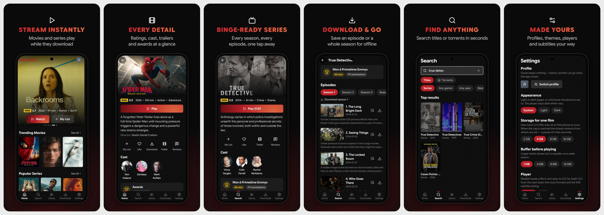
</p>

# Watchly

Movies and series streamed from torrents while they download — on Android
phones, Android TV and Windows.

**[Download the latest release](https://github.com/sammyZi/Watchly/releases/latest)** —
phone and TV APKs and the Windows exe.

- **Stream instantly** — a film starts playing while it downloads, and resumes where you left off
- **Every detail** — ratings, cast, trailers and awards on every title
- **Binge-ready series** — seasons and episodes, with what you've watched marked and Skip intro
- **Download & go** — save an episode or a whole season to watch offline
- **Find anything** — search titles, or torrents by name
- **Made yours** — profiles with PINs, light and dark themes, Media3 or VLC, subtitles in your language

## Disclaimer

Watchly is only a player. It does not host, upload, share or own any videos or
torrent files, and none come with it. It searches public, third-party indexes
and plays what you choose, through the BitTorrent protocol, the way any torrent
client does. You are responsible for what you stream or download, and for
following the copyright laws where you live. Please only watch what you have
the right to.

Watchly is built on open-source projects:

- [libtorrent](https://libtorrent.org) via [libtorrent4j](https://github.com/aldenml/libtorrent4j) — the torrent engine on Android
- [MonoTorrent](https://github.com/alanmcgovern/monotorrent) — the torrent engine on Windows
- [AndroidX Media3](https://github.com/androidx/media) with the [Jellyfin FFmpeg decoder](https://github.com/jellyfin/jellyfin-androidx-media) — the default player
- [VLC / libVLC](https://www.videolan.org/vlc/libvlc.html) and [LibVLCSharp](https://github.com/videolan/libvlcsharp) — the fallback player, and the player on Windows
- [Jetpack Compose](https://developer.android.com/jetpack/compose), [Coil](https://github.com/coil-kt/coil) and [Lucide](https://lucide.dev) icons — the look

Titles, artwork and episode lists come from [Cinemeta](https://v3-cinemeta.strem.io), Stremio's public catalogue,
intro timings from [IntroDB](https://introdb.app) and subtitles from [OpenSubtitles](https://www.opensubtitles.org) (through Stremio's add-on, no key needed) and [SubDL](https://subdl.com).

## Screenshots

### Phone

<table>
  <tr>
    <td>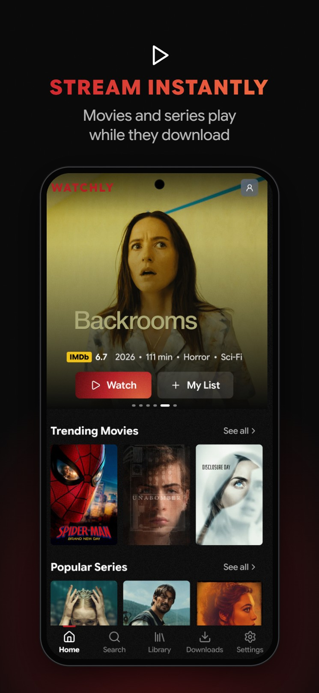</td>
    <td>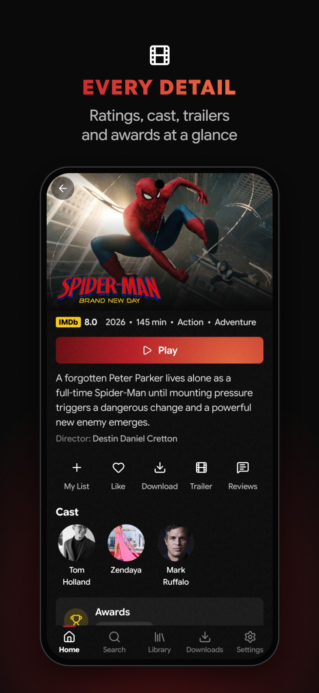</td>
    <td>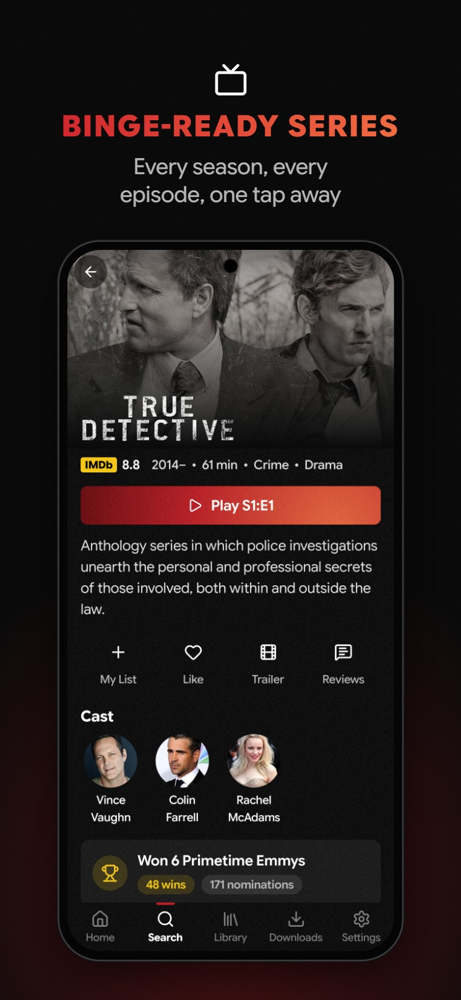</td>
  </tr>
  <tr>
    <td>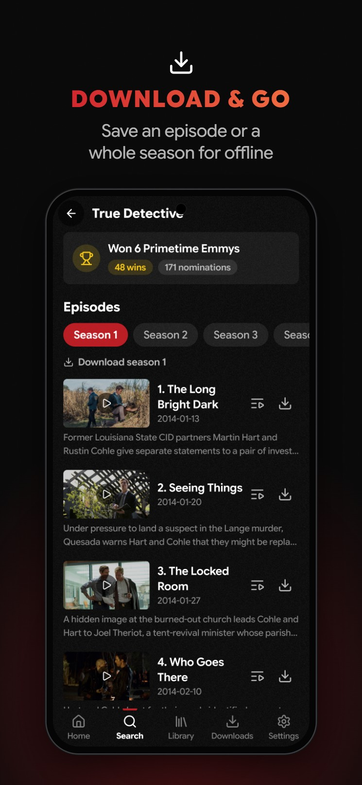</td>
    <td>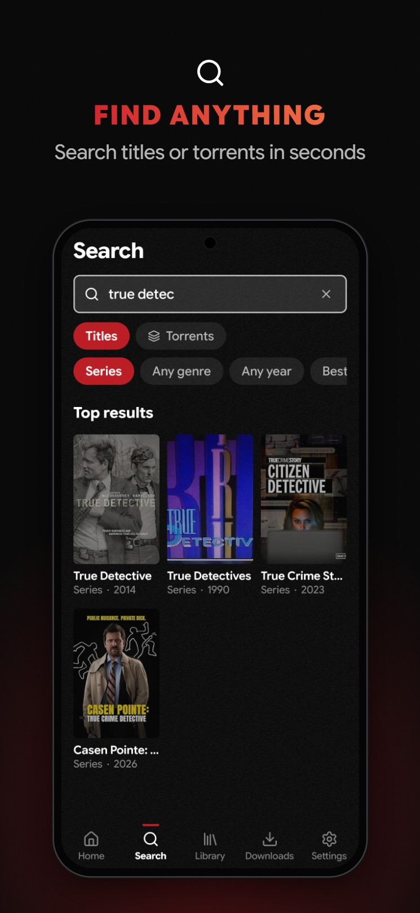</td>
    <td>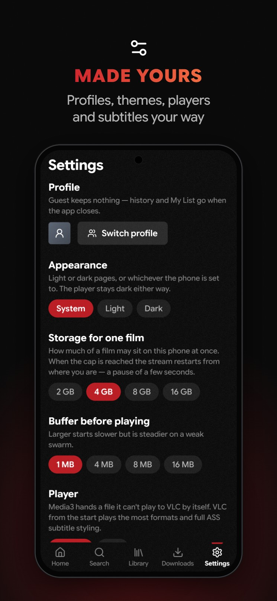</td>
  </tr>
</table>

### TV

<table>
  <tr>
    <td>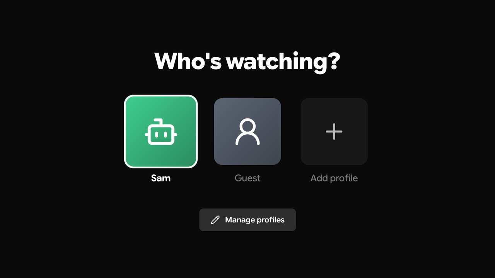</td>
    <td>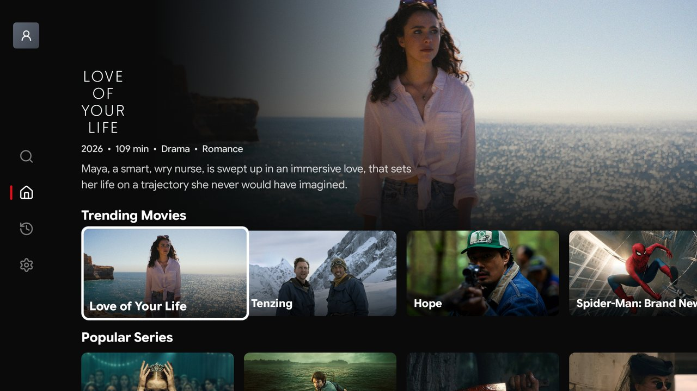</td>
  </tr>
  <tr>
    <td>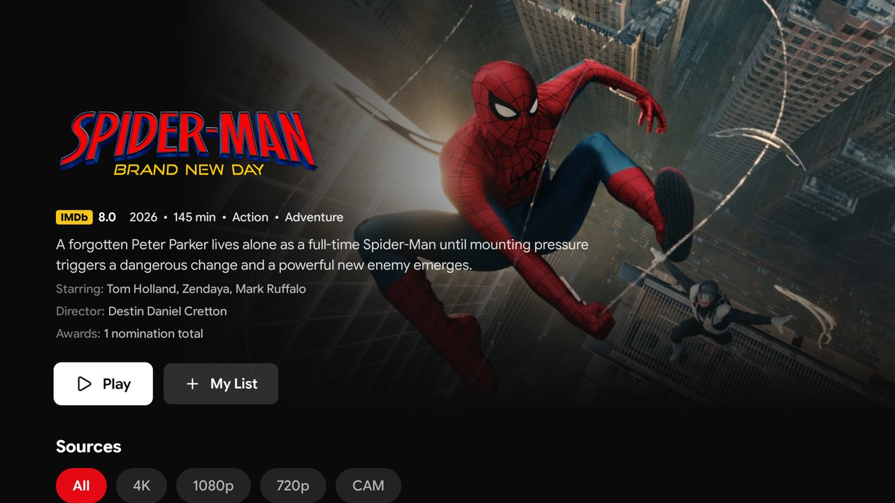</td>
    <td>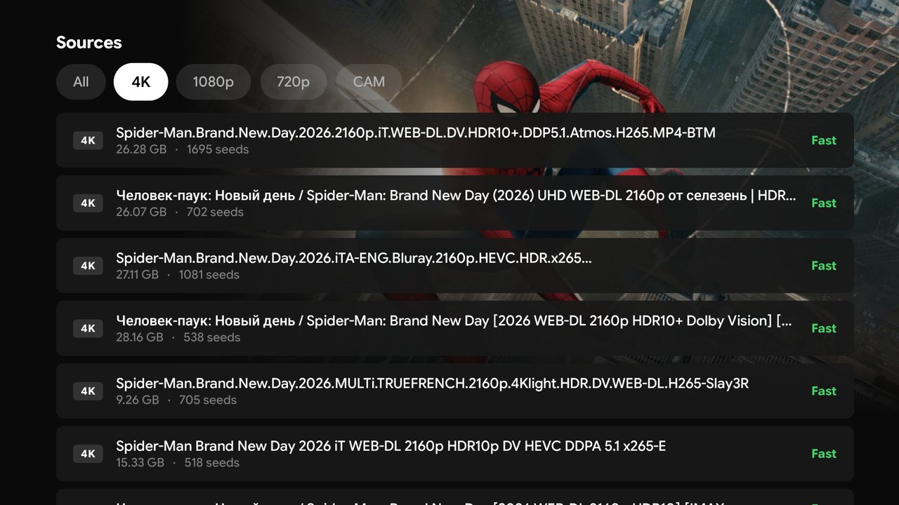</td>
  </tr>
  <tr>
    <td>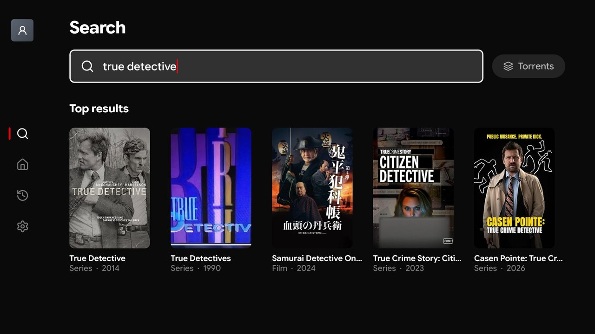</td>
    <td>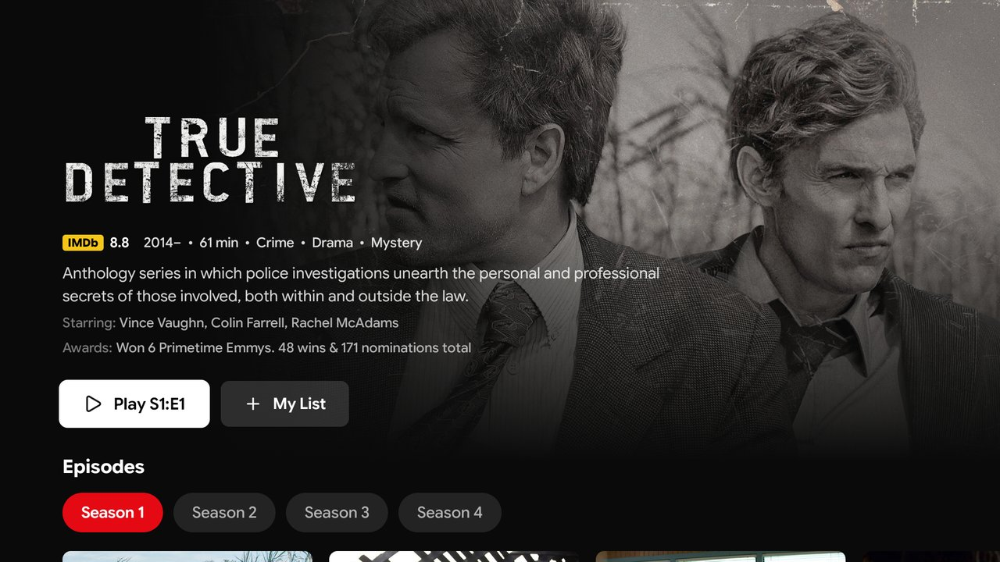</td>
  </tr>
  <tr>
    <td>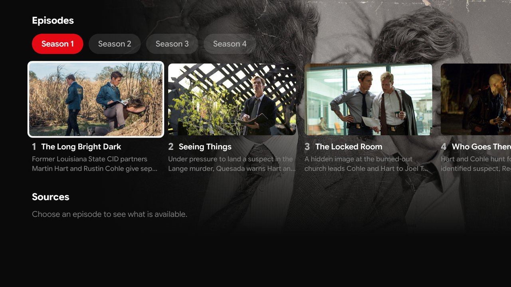</td>
    <td>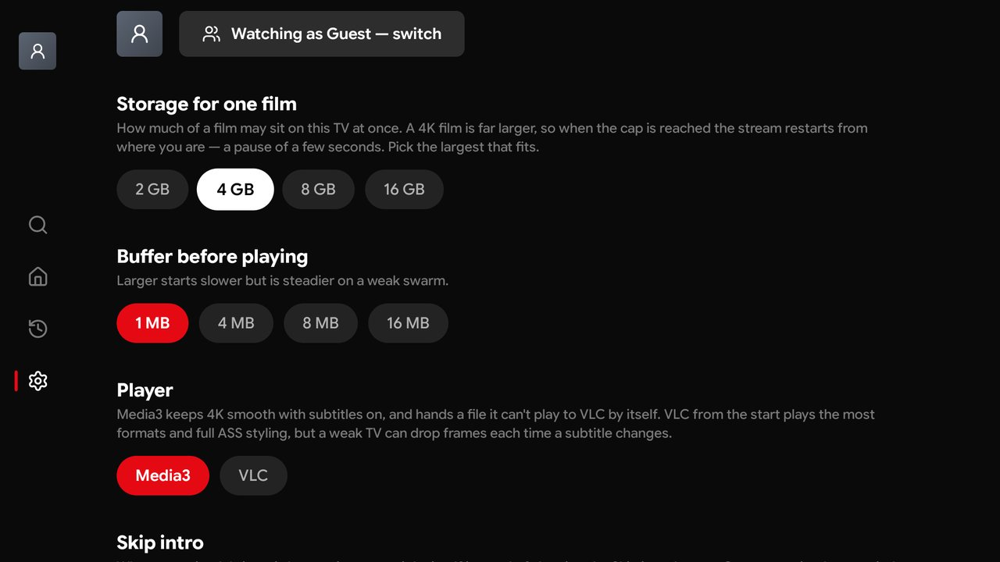</td>
  </tr>
</table>

## The apps

Three apps, each with its own README:

| App | Folder | Stack |
|---|---|---|
| Phone (Android) | [`mobile/`](mobile/README.md) | Kotlin + Compose on `tv/core`; libtorrent4j + Media3 / libVLC |
| Television (Android TV) | [`tv/`](tv/README.md) | Kotlin + Compose; libtorrent4j + Media3 / libVLC |
| Windows desktop | [`windows/`](windows/README.md) | MonoTorrent + LibVLCSharp (.NET 8, WPF) |

The phone and the TV share one Gradle module, `tv/core`: the torrent engine,
the players, indexers, metadata, the store and the look.

```bash
cd mobile && ./gradlew compileDebugKotlin
```

```bash
cd tv && ./gradlew compileDebugKotlin testDebugUnitTest
```

[`docs/`](docs/rolling-cache-architecture.md) has the rolling-cache design the
apps share.
